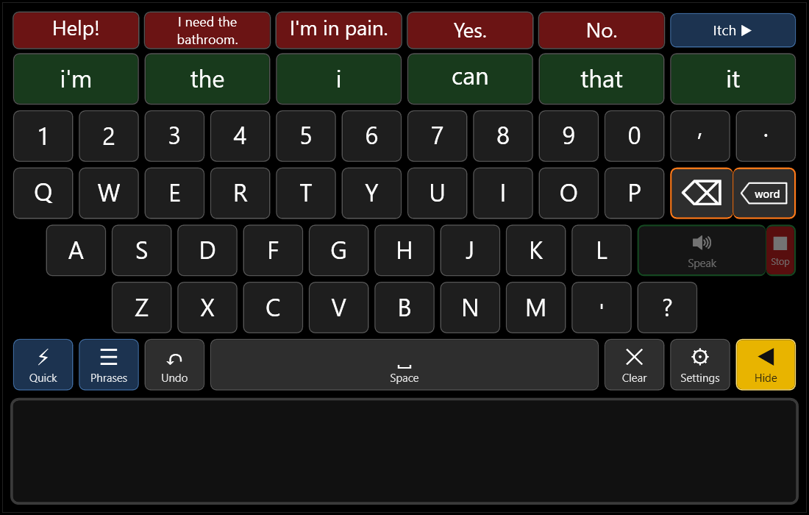

# BetterTalk (early beta)

A free, open-source Windows communication app (AAC) for people who cannot speak and control a computer with a
QuadStick, a head or mouth switch, a mouse, or an eye tracker that moves the mouse, for example people living
with ALS. The user builds a message by typing on a large on-screen keyboard (with word suggestions that learn
from them) or by choosing a stored phrase, can point to exactly where they itch on a 3D figure, and the app says
it out loud with a choice of free, natural-sounding voices that run entirely offline.

> **Status: early beta.** BetterTalk is new and has been used by very few people so far. Use it alongside an
> existing, proven AAC system, not instead of one, until the user (and ideally their speech-language
> pathologist) have checked that it is reliable for them. Please tell us what goes wrong: see
> [Report a problem or an idea](#report-a-problem-or-an-idea).



**Who it is for:** anyone who uses Windows with limited movement and wants a quick way to speak: QuadStick
and sip-and-puff users, switch and head-mouse users, mouse users, and the family and carers who set it up.
**What it is not:** a medical device, a replacement for a dedicated speech-generating device, or an app for
phones or Macs (Windows 10 and 11 only, for now).

## Download and install

**[Download BetterTalk-Setup.exe](https://github.com/Nelcyon/bettertalkopen/releases/latest/download/BetterTalk-Setup.exe)**
(Windows 10 or 11, 64-bit, about 60 MB). The link always gets the newest version.

1. Double-click the downloaded **BetterTalk-Setup.exe**. No administrator password is needed.
2. Windows will probably show a blue box saying **"Windows protected your PC"**. This appears for any new
   program that is not signed with a paid certificate; it does not mean a virus was found. Choose
   **More info**, then **Run anyway**. (See [Is this safe?](#is-this-safe) below.)
3. Press **Install**. BetterTalk opens, with icons on the Desktop and in the Start menu.

Nothing else needs installing. The installer contains only the app, not the voices: it speaks with the Windows
voice to start with, and natural voices can be picked and downloaded inside the app, under Settings → Voice & speaking.
To remove it: Windows Settings → Apps → Installed apps → BetterTalk → Uninstall.

### The first few minutes

1. The first time BetterTalk starts, a short **set-up guide** (about a minute) asks how the user chooses
   buttons, how BetterTalk should come back after hiding (a click or a rest in its corner, or a hotkey), which
   screen and corner it sits in, whether it hides by itself, and which voice to use. **Skip for now** keeps the
   usual choices. It can be run again from Settings → Screen & window, or the tray icon's Set-up and tools menu.
2. The red buttons along the top are a few urgent phrases (Help!, I need the bathroom., I'm in pain., Yes.,
   No.). Make them your own: Settings → Buttons, or **Edit buttons live** to change them on screen.
3. Pick a nicer voice in Settings → Voice & speaking. Each voice downloads once (70 to 350 MB) and then works
   with no internet.
4. Settings (the ⚙ key, or right-click the BetterTalk icon near the clock) has everything else, including the
   **QuadStick card** tab, which shows which sip, puff or key does what.

### Updates

Settings → **Updates** → **Check for updates** shows what is new and offers **Update to …**, which keeps a
snapshot of your version first so you can go back. Nothing is checked or downloaded unless you press the button.
Your settings, buttons and learned words are always kept.

## Is this safe?

- **All the code is here**, under the GPL-3.0 licence. Anyone can read it, and anyone can build the app
  themselves (see [Build it yourself](#build-it-yourself)).
- **The installer is built by GitHub, not on someone's PC.** Each release is made by the public
  [release workflow](.github/workflows/release.yml) on GitHub's own Windows machines, straight from the code
  in this repository; you can see every run on the [Actions](https://github.com/Nelcyon/bettertalkopen/actions)
  page.
- **Checksum.** Each release lists the SHA-256 checksum of BetterTalk-Setup.exe. To check your download, open
  PowerShell in your Downloads folder and run `Get-FileHash .\BetterTalk-Setup.exe`; the number must match the
  one on the [release page](https://github.com/Nelcyon/bettertalkopen/releases/latest).
- **Why Windows warns about it.** The installer is not code-signed yet (a signing certificate costs money every
  year). That is why SmartScreen says "Windows protected your PC". It is a warning about an unknown publisher,
  not a virus detection.
- **It stays on your computer.** No account, no cloud, no tracking, no ads. It never records audio. The only
  times it uses the internet are when you download a voice or press Check for updates. What it learns about
  your words is stored encrypted on your PC (see [Privacy defaults](#privacy-defaults)).
- **No administrator rights.** It installs into your own user folder, like many apps do.

## Report a problem or an idea

- **Easiest: from inside BetterTalk.** Choose Settings → Updates → **Send feedback** (or *Send feedback to the
  makers* in the tray menu), type with BetterTalk's own keyboard and press **Send feedback**. No account is
  needed. Only your feedback words, the BetterTalk version and the Windows version are sent.
- **[Open an issue on GitHub](https://github.com/Nelcyon/bettertalkopen/issues/new/choose)** (needs a free
  GitHub account). There is a short form for problems and one for ideas.
- Helpful to include: your BetterTalk version (Settings → Updates), your Windows version, how the user controls
  the computer (QuadStick, switch, mouse, eye tracker), and what you did just before it went wrong.
- If BetterTalk closed by itself, the files `errors.log` and `app.log` in `%APPDATA%\BetterTalk` say why. They
  never contain message text, so they are safe to attach. Please never post anything you or the user typed or
  said.

## What it does

| Area | What it does |
|---|---|
| One screen | Urgent red buttons on top, six green word suggestions, a number row and a QWERTY keyboard with large equal-size keys, and the message box. **Quick** and **Phrases** open drawers of stored phrases. Nothing moves or resizes while the user types. |
| Speech | **Speak** says the whole message, once per press; a red **Stop** cuts it off. The words are highlighted as they are said so others can read along. Optional word-by-word speaking. Windows voices plus dozens of free natural voices that run offline after a one-time download. |
| Word suggestions | About 59,000 English words, ranked by how common they are and by what the user says (learning can be turned off). The likeliest word sits in the middle of the green row. |
| Itch | A 3D body to click on, which writes a precise sentence ("I have an itch on my left inner thigh, just above the knee.") plus one-press words for the person scratching (Keep going, Scratch harder, That's the spot...). |
| Controls | Works with mouse clicks alone, or with keys and mouse buttons that you choose (Settings → Hotkeys, Settings → QuadStick card). |
| Works alongside other programs | Hide it with the yellow Hide button and bring it back from its corner, the tray icon or a hotkey. Its keys only work while it is in use, never system-wide. |
| Safe input | A held key, auto-repeat or bounced press cannot trigger an action twice. |
| Recovery | The unfinished message is saved encrypted and comes back after a crash, never spoken on its own. Errors are logged without any message text. |

## Controls

Every key below is a default that you can change. The QuadStick sends keyboard and mouse events,
so you can map any sip, puff, lip or joystick action to one of these keys in the QuadStick
spreadsheet. The app needs no particular QuadStick configuration. If the QuadStick is in mouse
mode, every target is also a large button you can click.

| Key | Action |
|---|---|
| Arrow keys | Move the yellow focus frame |
| Enter | Speak the message; while stepping with the arrows, select the framed item |
| F9 | Speak the message (F8 does the same, for older key settings) |
| Esc | Stop voice |
| Backspace | Delete letter |
| Delete | Delete word |
| Ctrl-C / Ctrl-X / Ctrl-V | Copy, cut or paste the whole message |
| F4 | Undo |
| Home | Close the open drawer |
| Any letter key | Typed straight into the message (this also works with the Windows On-Screen Keyboard) |

A right, middle or side mouse button can be one of these keys too (Settings → Hotkeys: click it in the box).
Settings → **QuadStick card** shows the same keys laid out like a sip-and-puff reference card, with the tubes
across and soft puff, puff, sip and soft sip down. Each square says what that gesture sends and what BetterTalk
does with it, and clicking a square changes it.

There is one screen and its layout is fixed: nothing moves or resizes while the user types. From the top: the
urgent phrases, six green word-suggestion slots (always there, blank when empty), the keyboard, and the message box. The bottom keyboard row has **Quick · Phrases** at the left;
each opens its drawer between the keyboard and the message box (one at a time; pressing it again or Home
closes it). The window grows downward by the drawer's height while one is open and shrinks back after, so
the keys never move or change size and there is no empty gap. Speak is the wide
key where Enter would be, with a small red **Stop** segment attached. The **Settings** key (⚙) at the right end of the bottom row opens Settings, and **Hide**
(yellow, ◀) ends the row in the bottom-right corner (always shown, whether or not auto-hide is on).
Settings can also be opened from the BetterTalk icon near the clock: right-click it for the menu. The message box at the bottom is three lines tall and scrolls to the newest words.
Problems such as a missing voice show for five seconds over the message box; there is no status text.

## Build it yourself

Requirements: Windows 10 or 11 (x64) and the [.NET 10 SDK](https://dotnet.microsoft.com/download/dotnet/10.0).
The SDK is needed to build. You do not need it to run a published copy.

```powershell
git clone https://github.com/Nelcyon/bettertalkopen
cd bettertalkopen
dotnet run --project src/Aac.App
```

To make a standalone copy that runs without installing .NET:

```powershell
dotnet publish src/Aac.App -c Release -r win-x64 --self-contained true -p:PublishSingleFile=true -o publish
.\publish\BetterTalk.exe
```

On first run the app writes its settings to `%APPDATA%\BetterTalk\settings.json`. Close the app
before editing that file. If the file cannot be read, the app starts with default settings and says so.

## Test it

```powershell
dotnet test tests/Aac.Core.Tests          # about 180 automated tests
dotnet run --project tools/Aac.Bench      # action-count table for the representative tasks
```

The tests cover:
- **Speech:** one Speak press says the message once, bounces and repeats inside the cooldown never replay, word mode says each finished word once and never re-speaks after delete or Undo, busy and stop, and late end-of-speech events.
- **Quick phrases:** they speak on one selection and their repeat guard works.
- **Pronunciation:** pronunciation fixes change only the audio.
- **Input:** auto-repeat, held keys across a focus switch, the focus guard, debounce, hold-to-activate and key mapping.
- **Navigation and editing.**
- **Storage:** draft recovery that is never spoken on its own, and settings that cannot be read.

The core logic is in `src/Aac.Core`. It has no Windows dependency, so the tests also run on Linux and macOS.
`src/Aac.App` (WPF) builds only on Windows. `.github/workflows/ci.yml` builds and tests everything on a
Windows runner once the code is in a GitHub repository.

## Reading along

While a message or quick phrase is being said, it stays in the message box with the word being said
highlighted in yellow (words already said in white, the rest grey), so the listener can read along. The
box clears when the voice finishes (if "clear after speaking" is on), or as soon as the user starts typing the
next message. The Windows voices report each word as they reach it; for natural voices the place is
worked out from how much of each sentence's audio has played.

## Pauses

An ellipsis ("..." or "…") in a button or a typed message is said as a 1-second pause: "Hang on... let me
think" says "Hang on", waits, then "let me think". It works with every voice, the highlight follows the words on both
sides, and Stop still cuts it off at once.

## Saved buttons

The button words (urgent row, quick phrases, phrase categories) are kept in their own file,
`%APPDATA%\BetterTalk\buttons.json`, and written the moment a button is changed (edit mode or Settings),
so a restart never loses them. Older installs had them in settings.json; the first start moves them over.

## Voices

Settings → **Voice** lists every voice. **Picking a voice downloads it (once, with a progress bar) and
then says a sample in it**, so voices can be compared by ear; **Hear it again** repeats the sample at the
chosen speed and volume. Voices already downloaded are marked ✓; the others show their download size.

- **Windows voices** (David, Zira, Mark): already installed and instant, but robotic.
- **Natural voices** (Piper, 23 single voices): start speaking about 0.1 s after a press. American men
  (Ryan, Joe, John, Norman, Bryce, Hi-Fi Male, Kusal, Danny, Reza), a non-binary voice (Sam), American women
  (Lessac, Kristin, Linda, Hi-Fi Female, Amy, Kathleen) and British and Scottish voices (Alan, Northern,
  Southern, Cori, Jenny, Alba, Southern Female). 70 to 115 MB each.
- **Voice sets** (Piper, one download per set): SEMAINE (4 British characters), CMU Arctic (18 speakers,
  American, Scottish, Canadian and Indian English), L2-ARCTIC (24 speakers with Arabic, Mandarin, Hindi,
  Korean, Spanish and Vietnamese accents) and ARU (12 Liverpool speakers).
- **Most natural voices** (Kokoro-82M, Apache 2.0): all 28 English voices, American and British. About a
  second before speaking; one 350 MB download for all of them. British voices use British pronunciations.
- **Kitten voices** (KittenTTS mini, Apache 2.0): 4 men and 4 women; about a second before speaking; one
  68 MB download.

Left out: voices whose licence could not be confirmed, voices imitating a game character, and the two
speaker sets too big for a list (VCTK, 109 speakers; LibriTTS, 904).

All natural voices run on this computer through [sherpa-onnx](https://github.com/k2-fsa/sherpa-onnx)
(Apache 2.0), with no account and no internet after the one-time download. They are downloaded from the
sherpa-onnx model releases into `%LOCALAPPDATA%\BetterTalk\voices`. Each voice's licence is shown in
Settings; all allow personal use, and a few (marked NC or "non-commercial") do not allow commercial use.
Audio plays through NAudio (MIT). **Stop** cuts any voice off at once. If a natural voice cannot be loaded,
the Windows voice speaks instead and a notice says why. A natural voice is downloaded before Settings saves
it, so the app never starts without its voice.

## Itch: show exactly where it itches

**Itch** at the right end of the top strip opens a full-height panel beside the keyboard with a realistic 3D
body on its own. Beside it, in a panel of its own, are the controls, **Move the figure**: a button for every
movement, so left clicks alone are enough; the small controller icon 🎮 in the figure's upper corner shows or
hides them. At the same time the red urgent buttons along the top turn into the words that are said out loud with one press, to
guide the person scratching (the **Itch ▶ / ◀** arrow shows which way the panel opens and folds); **Itch**
again brings the urgent buttons back. The window grows or shrinks by exactly the panels' width, so the
keyboard and message box never move.

- The user **clicks the spot on the figure** (QuadStick mouse mode). A red dot marks it and the message box gets
  a sentence for the person scratching, as exact as the click: "I have an itch on my left inner thigh, just
  above the knee.", "behind my right ear", "on the tip of my left ring finger", "in my left armpit", "on my
  right big toe" (left and right are always the user's own). **Speak** says it.
- Moving the figure, all smooth (the view glides to each change) and gentler the closer it is:
  - Mouse: **left-drag** turns it (side to side) and tilts it (up and down); **right-drag** moves it, the body
    following the pointer exactly; the **wheel** zooms in on whatever is under the pointer (up to 10x, enough
    to pick a finger).
  - Buttons, one for each way of moving it, laid out like a remote control and coloured by kind: **Turn left /
    right** ⟲ ⟳ (an eighth of a turn each, blue) with **Front** and **Back**; **From above / From below** ⇩ ⇧
    (teal); a cross of **Up, Down, Left, Right** arrows (purple) around **Whole body**, which brings the whole
    body back, centred; **Closer** and **Farther** (gold). Dragging, right-dragging and the wheel work as before.
  - Keys (Settings → Hotkeys, under "The Itch figure"): turn left/right (F6, F7), closer/farther (Page Up,
    Page Down) and move up/down/left/right (number pad 8, 2, 4, 6); from above / from below can be given keys too.
  - However far it is moved, the view stays on the body, so the figure never goes off screen.
- To guide the person scratching, the top strip shows words that are said out loud with one press: **Up, Down,
  Left, Right** and, out of the box, **Keep going, Scratch harder, Scratch softer, That's the spot, Stop,
  Thanks, that's better**. Change those words in Settings → Buttons & phrases, or tap them while "Change the
  words on the buttons" is on. Settings → Itch doll picks how they look: blue with a red outline (the usual),
  orange with a blue outline, or the colours of the Itch button.

**Itch** again closes the panel and brings the urgent buttons back.

### How updates work

Settings → **Updates** → **Check for updates** asks GitHub for the newest release and shows what is new in it
(its section of `CHANGELOG.md`); **Full feature list** shows its README. Nothing is checked or downloaded unless
you press the button. **Update to …** first keeps a snapshot of the version you have, with its settings,
buttons, panel layout and learned words (in `%LOCALAPPDATA%\BetterTalk\Snapshot`), then downloads the installer
and runs it quietly; BetterTalk closes and starts again as the new version, with your data kept as always.
**Go back to version …** restores that snapshot: the old program and its setup, as they were before the update.
Only the newest snapshot is kept.

### Moving the panels (Unlock UI)

Out of the box the panels sit beside the keyboard and the window grows for them. Only the keyboard and the
panels are drawn: the window around them is see-through, so a panel is exactly as big as what is in it.
**Unlock UI to move the panels** (the tray menu), or unticking **Lock UI** in Settings → Screen & window, turns
on move mode: every panel gets a dashed outline, its buttons and the figure stop reacting, and pressing anywhere
on a panel drags it, anywhere on any screen. A dragged panel snaps to the edges of the keyboard, the other
panels and the screen, and slides along an edge it is held against. A panel that has been dragged out can be
resized by its edges (the controls panel always stays as tall as its buttons). **Lock UI** on the label at the
bottom ends move mode; **Put panels back** returns everything beside the keyboard. Floating panels never take
the keyboard from BetterTalk, and they hide and show with it. The arrangement is kept in `layout.json`.

The body is the male "realistic" base mesh from Blender Studio's
[Human Base Meshes](https://www.blender.org/download/demo-files/#assets) bundle v1.4.1, released under
CC0 1.0 (public domain). It is exported without the eyes as `src/Aac.App/Assets/body.obj.gz` (1.75 m tall,
y up, facing +z) and embedded in the app. The figure wears dark green shorts with gold trim, cut from the
body mesh itself. A clicked point is named by the nearest of the simple regions in
`Mannequin.Parts`, which are fitted to that body.

## Sentence options (removed)

Turning a few keywords into full sentences was tried and removed: without a capable
language model it could not offer useful options. The offline rules and the local-model client are
still in `src/Aac.Core/Generation` (unused) in case it is revisited.

## Privacy defaults

| Setting | Default | Meaning |
|---|---|---|
| `Privacy.RecoverUnfinishedMessage` | on | Saves only the current unfinished message, encrypted. It is deleted once the message is spoken or cleared. |
| `Privacy.LearnFromSpokenMessages` | **on** | Learns the user's words, word pairs and repeated messages from what the user speaks. Words the user uses get suggested first, and messages said twice appear under "★ Most used" on the Phrases page. It is not a log: a message said once is kept only as a salted one-way fingerprint (no text), word pairs are saved only once they have been said twice, messages that look private (a password or pin, a run of four or more digits, an email address) are never learned from, only the day is stored, and anything unused for a year is forgotten. Stored encrypted in `%APPDATA%\BetterTalk\learned.bin` (Windows DPAPI, so only this Windows account can read it). "Forget learning" on the Phrases page (select it twice) erases it. |
| `Generation.ShareRecentMessagesWithLocalAi` | **off** | Gives the local model the user's last five spoken messages as background. |

The app never records audio, never uses a cloud service, and keeps no history of spoken messages on disk: what it learns is described above, and the error log never contains message text.

## Layout

```
src/Aac.Core      UI-independent logic: speech safety, input gate, prediction, sentence options, session
src/Aac.App       WPF window, floating panels, set-up guide, SAPI speech, DPAPI encryption, hotkeys
tests/            xUnit tests for Aac.Core
tools/Aac.Bench   simulated-user action counts
```

## Word list credit

Word suggestions use an English list of about 59,000 words built from [wordfreq](https://github.com/rspeer/wordfreq) 3.1.1 by Robyn Speer (data CC BY-SA 4.0). `tools/wordlist/make_wordlist.py` rebuilds it.

## Licence

BetterTalk is free software under the [GNU General Public License v3.0](LICENSE): you can use, change and share it, and any version you share must stay free and open under the same licence. The word list, body model and libraries keep their own licences; see [THIRD_PARTY_NOTICES.md](THIRD_PARTY_NOTICES.md).
